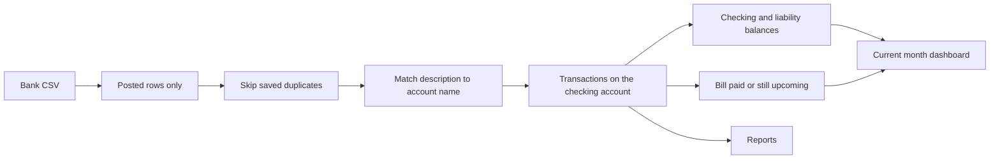

# Budget app, in small phases

Implement one phase at a time and stop for review before the next. This is a local app for one person. There is no `users` table and no `user_id` on any table.

Stack stays as it is: Next.js 16 App Router, Server Components, `pg` and `DATABASE_URL`, dynamic private data inside `<Suspense>` (no `"use cache"`). Read the matching guide in `node_modules/next/dist/docs/` before each phase. Routes live under [`app/`](app/); feature code is added only in the phase that needs it.

The sample file [`/Users/greg/Downloads/AccountHistory.csv`](/Users/greg/Downloads/AccountHistory.csv) is a 24-row October 2026 export for one masked account (`******7502`). Columns: Account Number, Post Date, Check, Description, Debit, Credit, Status, Balance, Classification. Balance and Check are empty. Every row in the sample is `Posted`. Classification already has labels, including the HTML entity for `Mortgage & Rent`.

## Accounts

Types: `checking`, `income`, `credit_card`, `loan`, `bill`, `household`, `other`.

- **Checking** is where a bank CSV is imported. It has a cash balance.
- **Credit Card** and **Loan** have balances shown as amount owed.
- **Income**, **Bill**, **Household**, and **Other** are match targets. A transaction stays on the checking account and is linked to one of these when its description contains that account’s name. Netflix, PennyMac, and Verizon are accounts named after the bank text, not separate categories.
- **Bill**, and optionally **Credit Card** and **Loan**, can carry a monthly expected amount and due day for the dashboard forecast.

Store money as integer cents.

- One `amount_cents` on each transaction: CSV Credit is positive (money in), CSV Debit is negative (money out).
- Checking opening balances are stored positive. Credit card and loan opening balances are stored negative (amount owed). The UI shows those as “owed” by flipping the sign.
- Running balance for Checking, Credit Card, and Loan: opening balance plus later transactions on that account. “Balance as of” is the balance at the end of that date. Earlier imported rows stay in history and do not move the current balance.
- A checking payment whose description matches a credit card or loan also moves that liability: the payment reduces what is owed. Bill, income, household, and other accounts do not have a running balance.

Bank Classification is stored as text for reference. It is not a separate category system. Income is anything linked to an Income account. Spending is anything linked to Bill, Household, or Other. A payment linked to a Credit Card or Loan is a transfer, not spending.

## Phase 1 — Database and accounts

Add `lib/db.ts` (a `pg` pool), `db/migrations/001_foundation.sql`, and `npm run db:setup` to apply migrations. Document nothing new in [`.env.example`](.env.example); `DATABASE_URL` is already there.

Tables:

- `accounts` — name, type, optional institution and mask (`7502`), `opening_balance_cents`, `opening_on`, archived flag. Opening balance applies to Checking, Credit Card, and Loan.
- `transactions` — `account_id` (the account the row was imported onto), optional `matched_account_id`, `posted_on`, description, `amount_cents`, optional check number, status, classification text, `fingerprint` unique. Empty in this phase.
- `import_batches` — file name, account, row counts. Empty until phase 2.

Screens:

- [`app/accounts/page.tsx`](app/accounts/page.tsx) lists accounts. Checking, credit cards, and loans show a computed balance. The other types show their name and type only.
- `app/accounts/new/page.tsx` creates an account: name, type, and for balance types a balance as of a date.
- A small nav on [`app/layout.tsx`](app/layout.tsx) links Home and Accounts. Home stays the placeholder until phase 3.

## Phase 2 — Import the bank CSV

Add `features/import/` for parsing, filtering, dedupe, and name matching, plus [`app/import/page.tsx`](app/import/page.tsx).

- Parse with a real CSV parser. Decode HTML entities in Classification.
- User picks the account the file belongs to (usually Checking) and uploads the file.
- Drop every row whose Status is not `Posted`. Pending or blank statuses never insert.
- Duplicates are ignored. The fingerprint is a hash of the import account, date, description, amount, and check number, plus an occurrence index when the same day has identical rows (two Amazon charges). The preview lists new rows and a separate “duplicates ignored” group. Confirm imports only the new rows. The unique fingerprint is the backstop if the same file is submitted again.
- Match each new row’s description to an account name, case-insensitive. The description must contain the full account name, and the name must be at least 3 characters so a short name does not match everything. The import account itself is not a match target. If several names match, the longest name wins. The preview shows the suggested account and lets the user change or clear it before confirm. Example: an account named `Netflix` matches the description `Netflix`; `PennyMac` matches `PennyMac`.
- On confirm, insert the new posted rows with `matched_account_id`, and record the batch.
- `app/accounts/[id]/page.tsx` lists that account’s own transactions and, for a bill or other match target, the checking transactions linked to it.

First manual check: create Checking plus accounts named Netflix and PennyMac, import `AccountHistory.csv`, confirm only Posted rows insert and those two descriptions are matched, then import the file again and confirm every row is ignored as a duplicate.

## Phase 3 — Recurring bills and the current-month dashboard

Add schedule fields on Bill, Credit Card, and Loan accounts: `expected_amount_cents`, day of month, active flag. Editing the account sets them.

- A bill, card, or loan is paid this month when a Posted transaction is linked to it with `posted_on` in the month.
- Unpaid active schedules whose due day is still in the month are upcoming.

Replace [`app/page.tsx`](app/page.tsx) with the current calendar month:

- Cash on hand: Checking balances.
- Owed: each credit card and loan, plus the two totals. A matched payment already posted reduces the owed amount.
- Month-to-date income: transactions linked to Income accounts.
- Month-to-date spending: transactions linked to Bill, Household, or Other. Transfers to a card or loan are left out.
- Upcoming: due day, account name, expected amount.
- Projected end-of-month cash: current checking total, plus expected income still to post, minus upcoming bills and loan or card payments that leave checking.

## Phase 4 — Reports

Add [`app/reports/page.tsx`](app/reports/page.tsx) and one client chart component. Use a small client chart library only in this phase.

- Spending line for one account: daily outflows on a Checking account, or daily amounts linked to a Bill, Household, or Other account.
- Balance history for Checking, Credit Card, and Loan: reconstructed end-of-day balance from the opening balance and transactions.
- Income vs expenses by month, using the same link rules as the dashboard.

## Phase 5 — Fit and finish

- Empty states: no accounts, no transactions, no upcoming bills.
- Archive an account without deleting its history. Archived names no longer auto-match.
- Edit a transaction’s matched account, and a bill’s expected amount or due day.
- Verify each screen in the browser on the dev server (port 31000): create the sample accounts, import `AccountHistory.csv` twice, confirm non-posted rows and duplicates are ignored, confirm Netflix and PennyMac match, and confirm the dashboard and reports follow those links.

Out of scope until a later request: login, bank API connections, budgets-by-category targets, and split transactions.
